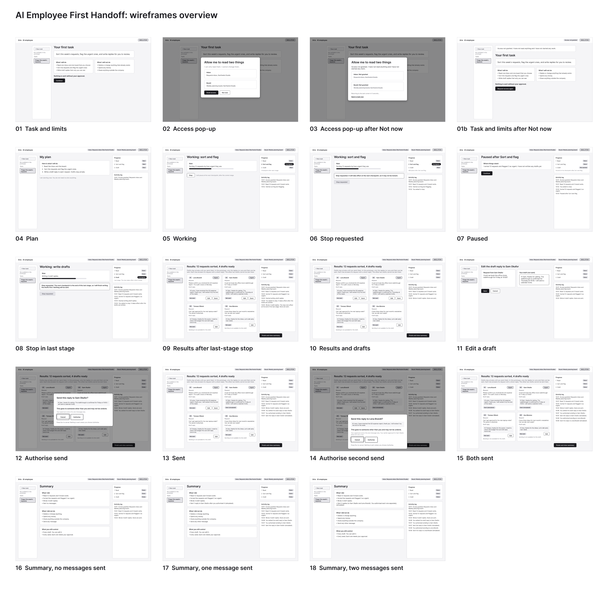

# AI Employee First Handoff

A small portfolio project exploring how to help a first-time user hand real work to an AI employee, with a focus on making delegation feel safe.

This is an independent concept inspired by the AI employee product category. It is not a reproduction of any vendor's product or onboarding.

## Problem hypothesis

Users who are comfortable with conversational AI may hesitate to delegate tasks to an AI employee because they are uncertain about what it will do independently and how they can retain control.

This is a hypothesis, not a validated finding.

## Intended user

Someone who is familiar with tools like ChatGPT but has never delegated meaningful work to an AI employee. The working persona is **Maya**, an operations lead at a fictional 30-person company.

## Current stage

**Early design.** The brief, decisions and risks are written and low-fidelity wireframes of the scene are in `design/`. There is no prototype code yet.

## Planned prototype

A small general AI employee workspace with one working scene, in which Maya delegates inbox triage (other tasks are not built): the AI sorts and flags requests and drafts replies. Everything stays private and read-only until Maya explicitly authorises a send. Either of two specific replies can be sent, and each needs its own separate approval. An approval covers that single action only.

Control is shown through a plan before action, a visible activity log and a stop control. Sending cannot be undone, and the interface says so.

All wireframes are in [design/](design/README.md).

## Fictional data and simulated functionality

All people, companies and messages are fictional. Integrations and AI execution will be simulated. Nothing here represents a production-ready AI employee.

## Structure

- `docs/brief.md`: problem, user, the scene step by step, AI boundaries, scope
- `docs/decisions.md`: product decisions and the reasoning behind them
- `docs/risks-and-assumptions.md`: what is still unsure
- `design/`: wireframes as images
- `prototype/`: code (empty for now)

## Working principles

- This is a portfolio and learning exercise. All companies, people and data are fictional and no confidential employer information is used.
- The project was developed with AI assistance. Product decisions are mine.
- Hypotheses are not treated as established user needs.
- Important decisions and their reasoning are recorded in `docs/decisions.md`; uncertainties in `docs/risks-and-assumptions.md`.
- The prototype stays deliberately small: front-end only, with no authentication, databases or external integrations unless explicitly approved.
- Simulated functionality is clearly distinguished from real integrations and AI execution and the prototype is never presented as a production-ready AI employee.
